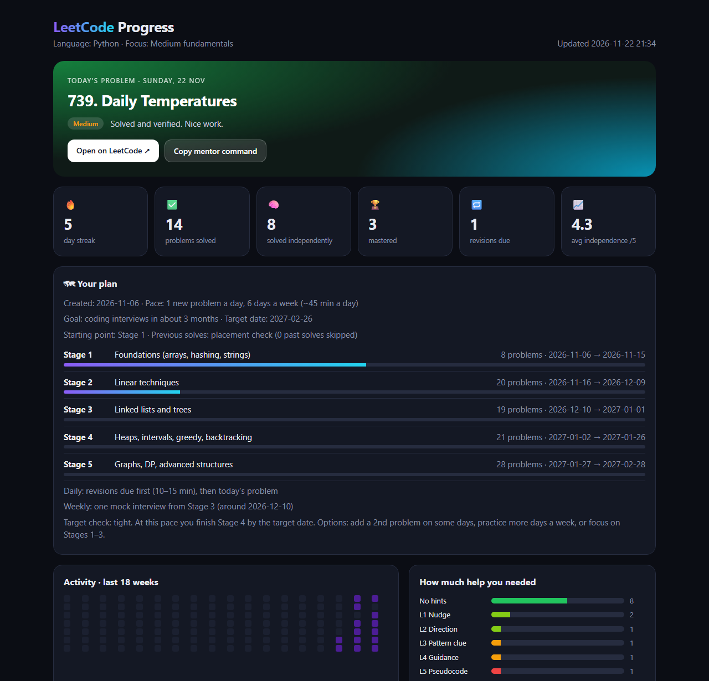
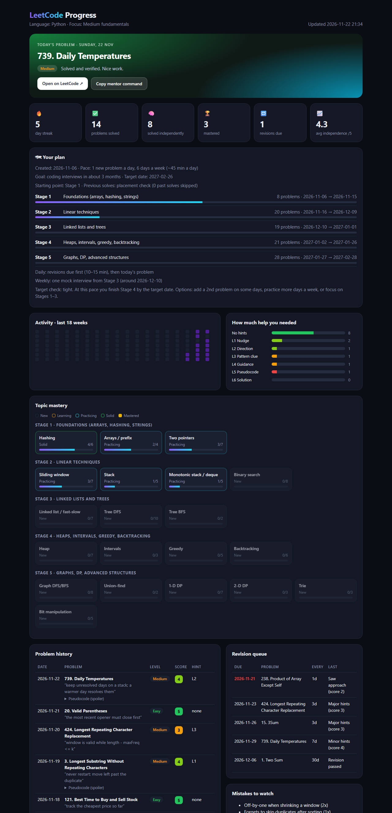
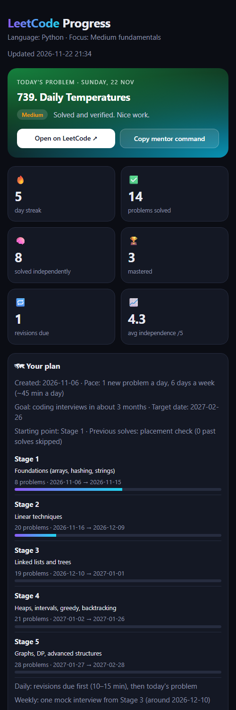

<div align="center">

# 🧠 leetcode-mentor

### A Claude Code skill that teaches you to solve LeetCode problems on your own, instead of solving them for you.

Socratic coaching · 6-level hint ladder · topic primers · daily problem picked from your progress · spaced revision · mock interviews · HTML progress dashboard · desktop reminders

[](LICENSE)
[](https://code.claude.com/docs/en/skills)
[](#requirements)
[](#requirements)



</div>

---

## Why this exists

Most AI help for LeetCode gives you the answer. You read it, it makes sense, and a week later you can't solve a similar problem. **Reading a solution isn't learning to solve.**

`leetcode-mentor` makes Claude act like a good human coach:

- **You do the thinking.** It asks one question at a time and never starts with code.
- **Brute force first.** You can't explain an optimization without knowing what it improves on.
- **Patterns through *why*.** You learn the clues, the conditions, and when a technique breaks, not "this is a sliding window problem".
- **Honest feedback.** Wrong approaches get a counterexample, and unexplained complexity claims get challenged.
- **Honest scoring.** "Accepted" or "I read the solution" is never counted as mastered.

> **The goal is to need it less.** After consistent use, you should be able to solve unfamiliar problems without Claude.

## Contents

- [Features](#features)
- [Screenshots](#screenshots)
- [Requirements](#requirements)
- [Installation](#installation)
- [Quick start](#quick-start)
- [How a problem session works](#how-a-problem-session-works)
- [The hint ladder](#the-hint-ladder)
- [Daily problem, dashboard & reminder](#daily-problem-dashboard--reminder)
- [Solving on LeetCode, verifying here](#solving-on-leetcode-verifying-here)
- [Progress tracking & privacy](#progress-tracking--privacy)
- [Commands reference](#commands-reference)
- [Repository layout](#repository-layout)
- [Limitations](#limitations)
- [Contributing](#contributing)
- [License](#license)

## Features

| | |
|---|---|
| 🎯 **Onboarding & study plan** | The first session asks your goal, time, language and experience, and **whether to count your past solves, start fresh, or take a 5-question placement check**. Then it builds a dated, stage-by-stage plan matched to your target date. |
| 🪜 **10-step workflow** | Understand → examples → brute force → bottleneck → pattern → plain-English algorithm → **your pseudocode** → your code → dry run → complexity → reflection |
| 💡 **6-level hint ladder** | Nudge → Direction → Pattern clue → Guidance → Pseudocode → Solution. One level per request, never skipped. |
| 📚 **Topic primers** | Never seen a linked list or a heap? It pauses the problem and teaches the basics interactively, then brings you back. This doesn't count as a hint. |
| 🧩 **22 patterns** | Hashing to union-find, each taught with recognition clues, conditions, a template, failure cases and look-alikes |
| 📅 **Daily problem** | Picked automatically from your progress, out of a curated 110-problem ladder (every problem checked against LeetCode) |
| 🔁 **Spaced revision** | Problems come back after 1 → 3 → 7 → 14 → 30 days, sooner if you struggled |
| 🎤 **Mock interviews** | A neutral interviewer, no free hints, follow-up questions, and a scored debrief in 6 areas |
| 🔍 **Code review** | Points to the bug with an input that breaks it, and never rewrites your code |
| ✅ **LeetCode verification** | Solve on leetcode.com, say "done", and it confirms your Accepted submission, checks you understand it, and logs an honest score |
| 📊 **Progress dashboard** | A single HTML page: streak, heatmap, plan, topic mastery, hint usage, revision queue |
| 🔔 **Desktop reminder** | A daily Windows notification with today's problem, plus *Solve now*, *Progress* and *Snooze* buttons |

## Screenshots

<table>
<tr>
<td width="62%" valign="top">

**Progress dashboard** (`leetcode-progress.html`), regenerated after every session



</td>
<td width="38%" valign="top">

**Works on phones too**



**Daily reminder card** (Windows notification)


The notification shows this card with **Solve now** (opens LeetCode), **Progress** (opens the dashboard) and **Snooze** (10 min to 3 h).

</td>
</tr>
</table>

<sub>The screenshots use [made-up demo data](docs/demo/leetcode-log.md).</sub>

## Requirements

| | Needed for |
|---|---|
| [Claude Code](https://code.claude.com) (CLI, desktop app, or IDE extension) | Everything |
| Python **3.8+**, standard library only | Daily problem, dashboard, LeetCode checks (optional) |
| Windows 10/11 | Rich desktop notification (optional; macOS and Linux get a basic one) |

The coaching works without Python. You only lose the automation.

## Installation

Claude Code loads skills from `~/.claude/skills/<name>/SKILL.md`. Clone this repo there:

**macOS / Linux**
```bash
git clone https://github.com/SushanthKumble/leetcode-mentor.git ~/.claude/skills/leetcode-mentor
```

**Windows (PowerShell)**
```powershell
git clone https://github.com/SushanthKumble/leetcode-mentor.git "$HOME\.claude\skills\leetcode-mentor"
```

That's it. Claude Code picks the skill up automatically. If `/leetcode-mentor` doesn't show up in the `/` menu, run `/reload-skills` or restart Claude Code.

<details>
<summary><b>Other ways to install</b></summary>

**Only for one project:** clone into `<your-project>/.claude/skills/leetcode-mentor` instead.

**Claude.ai (web or desktop chat):** download this repo as a ZIP, keep the `leetcode-mentor/` folder with `SKILL.md` at its root, and upload it under *Settings → Capabilities → Skills*. The coaching works there. Scripts, progress saving and reminders don't, because chat has no local files.

**Developing the skill:** clone it anywhere, then link it into your skills folder so edits apply immediately:
```powershell
New-Item -ItemType Junction -Path "$HOME\.claude\skills\leetcode-mentor" -Target "C:\path\to\leetcode-mentor"   # Windows
```
```bash
ln -s /path/to/leetcode-mentor ~/.claude/skills/leetcode-mentor   # macOS / Linux
```
</details>

**Update:** `git -C ~/.claude/skills/leetcode-mentor pull`

## Quick start

1. **Make a practice folder** and open Claude Code in it. Your log and dashboard live there.
   ```bash
   mkdir ~/leetcode-practice && cd ~/leetcode-practice && claude
   ```
2. **Run the skill:**
   ```
   /leetcode-mentor
   ```
3. **Answer the setup questions,** one at a time, about 2 minutes. The mentor saves your profile and a dated study plan to `leetcode-log.md` (it asks before creating anything).
4. **Solve today's problem** with the mentor, or on leetcode.com, then come back and say "done".
5. *(Optional)* **Turn on the daily reminder** (Windows):
   ```powershell
   & "$HOME\.claude\skills\leetcode-mentor\scripts\install-reminder.ps1" -PracticeDir "$HOME\leetcode-practice" -Time 09:00 -TestNow
   ```

You don't need to remember any commands. Just talk:

| Say | What happens |
|---|---|
| "Let's practice" / "Give me a problem" | Today's problem, or one picked for your level |
| *(paste a problem)* | Guided practice through the 10 steps |
| "hint" / "I'm stuck" | The next hint level, or a diagnostic question |
| "show solution" | The full solution (logged honestly) |
| "review my code" *(paste code)* | Bugs located with an input that breaks them, plus complexity and an interview-readiness check |
| "I don't know linked lists" | A short interactive primer, then back to the problem |
| "teach me sliding window" | An interactive pattern lesson |
| "mock interview" | A realistic interview with a scored debrief |
| "let's revise" | Spaced-repetition recall of past problems |
| "done" / "solved it on LeetCode" | Verify, review, and log it |
| "show my progress" | Opens the dashboard |
| "redo my plan" | Changes your pace or target date |

## How a problem session works

```
You:    /leetcode-mentor 3. Longest Substring Without Repeating Characters

Mentor: In your own words, what are we given, and what exactly do we return?
You:    A string, and we return the longest substring with no repeats.
Mentor: Close. Check Example 1's output. Is it the substring, or something else?
You:    Oh, the length.

  … you trace examples, then propose a brute force: check every substring, O(n²) with a set …

Mentor: Correct. When "abca" fails at the second 'a', your loop restarts at 'b'
        and rebuilds everything. What did you already know about "bc"?
You:    That it was fine… so I only need to drop the first 'a'?
Mentor: Exactly. You just found the bottleneck. What would you need to store so that
        "is this character in my range?" is instant?

  … you derive the sliding window, explain it, write pseudocode, then code it …

Mentor: Dry-run "abba" through your code. What's `left` after index 3?
  … you find your own off-by-one bug …

Mentor: Complexity? There's a while loop inside your for loop. Justify it.
You:    Each character enters and leaves the window at most once, so O(n).
Mentor: In one or two sentences, in your own words: what will you remember?

  → Logged: "Minor hints (score 4) · max hint L1", revision in 7 days, dashboard updated.
```

The ten steps, and what must be true before moving on:

| # | Step | You must… |
|---|---|---|
| 1 | Understand | restate input, output and constraints correctly |
| 2 | Examples | trace one by hand and invent an edge case |
| 3 | Brute force | give a correct simple approach, with its time and space |
| 4 | Bottleneck | name the wasted work |
| 5 | Pattern | say *why* a technique removes that waste |
| 6 | Algorithm | explain it in plain English, **then write pseudocode** |
| 7 | Code | implement it (bugs are pointed out, not fixed for you) |
| 8 | Test | dry-run normal, edge and adversarial cases |
| 9 | Complexity | justify time and space from the code |
| 10 | Reflect | state the takeaway in your own words |

## The hint ladder

Say **"hint"** at any time. Each request moves exactly **one** level:

| Level | You get | Score if it's your highest |
|---|---|---|
| — | No hints | **5** Independent |
| L1 Nudge | An observation you overlooked | **4** Minor hints |
| L2 Direction | A property worth investigating | **4** |
| L3 Pattern clue | A pointer toward a technique | **3** Major hints |
| L4 Guidance | A step-by-step derivation, through questions | **3** |
| L5 Pseudocode | Pseudocode, not real code | **2** Saw the approach |
| L6 Solution | The full solution, explained | **1** Copied |

Hints are specific to *your* current attempt, never generic advice like "think about the constraints". **"Show solution"** skips the ladder, so you're never stuck.

A problem is **mastered** only when you've solved it independently, explained it in your own words, *and* passed a revision at least 7 days later.

## Daily problem, dashboard & reminder

**How today's problem is chosen** (from a curated ladder of 110 free LeetCode problems in 5 stages):

1. It starts from your plan's starting stage, with foundations before advanced topics.
2. It finishes topics you've started before opening new ones, and never gives the same topic two days in a row.
3. **Every 4th day is a mystery review:** an unlabeled problem from an earlier topic, to train recognition.
4. Difficulty goes up after 3 strong solves in a row and down after 2 struggles.
5. A skipped problem comes back once, and problems you've already solved (here or on LeetCode) are skipped.
6. The reason it gives never reveals the pattern.

| Stage | Topics |
|---|---|
| 1 | Hashing, arrays & prefix sums, two pointers |
| 2 | Sliding window, stack, monotonic stack, binary search |
| 3 | Linked lists, tree DFS/BFS |
| 4 | Heaps, intervals, greedy, backtracking |
| 5 | Graphs, union-find, 1-D/2-D DP, trie, bits |

**Dashboard:** `leetcode-progress.html` in your practice folder, rebuilt after every session. Ask *"show my progress"*, or open the file directly.

**Reminder (Windows):** `install-reminder.ps1` creates a per-user scheduled task (no admin rights) that picks the problem, refreshes the dashboard and shows the notification each day. If your computer was off at that time, it runs at the next start. Remove it with `install-reminder.ps1 -Uninstall`.

**macOS / Linux:** `mentor.py daily --notify` sends a basic notification. Schedule it with cron:
```cron
0 9 * * *  cd ~/leetcode-practice && python3 ~/.claude/skills/leetcode-mentor/scripts/mentor.py daily --dir . --notify
```

## Solving on LeetCode, verifying here

Prefer the real LeetCode editor? Solve there, then tell the mentor **"done"**:

1. With your **public username** in your profile, it reads your public *Accepted* list and confirms the problem, language and time.
2. You paste your code, or save it as `solutions/<number>-<slug>.<ext>`.
3. It asks one honest question, *"Did you use hints, the editorial, or AI?"*, and then runs an **understanding check**: your approach, the complexity and why, and the clue that led you there.
4. It gives a short review (complexity versus optimal, edge cases LeetCode's tests may miss, readability, interview readiness) and logs an honest score.

> *Accepted* proves the code passes LeetCode's tests. It doesn't prove you could do it again. A solution you can't explain is logged as exactly that.

**No password, no cookie, ever.** LeetCode has no official API, so this uses the public endpoint its website uses. It's read-only, it can break without warning, and the fallback is simply "paste your code". LeetCode only shows your recent submissions publicly, and never your code.

## Progress tracking & privacy

Everything lives in **one Markdown file you own**, `leetcode-log.md`, in your practice folder:

```
## Profile          language, goal, pace, start stage, (optional) LeetCode username
## Study plan       dated roadmap by stage
## Daily problem    one line per day: pending / accepted / done / skipped
## Revision queue   what's due, and when
## Pattern mastery  New → Learning → Practicing → Solid → Mastered
## Mistake patterns recurring bugs and misconceptions
## Problem history  a short learning summary per problem (with your pseudocode)
```

- **Plain text:** read it, edit it, or commit it to your own private repo. The mentor treats your edits as the truth.
- **Never invented:** if something isn't in the log, the mentor says so.
- **Asks first:** the mentor asks before creating the file.
- **No telemetry, no accounts, no settings changes.** The only network call is the optional LeetCode check, which sends your public username to LeetCode alone.
- **Kept out of git:** this repo's `.gitignore` excludes `leetcode-log.md` and `leetcode-progress.html`, so personal logs are never committed.

## Commands reference

You rarely need these, because the mentor runs them for you. Run them from your practice folder (`S=~/.claude/skills/leetcode-mentor/scripts`):

| Command | What it does |
|---|---|
| `python $S/mentor.py daily --dir . [--notify] [--open]` | Picks today's problem, updates the log and dashboard, and optionally notifies |
| `python $S/mentor.py dashboard --dir . [--open]` | Rebuilds `leetcode-progress.html` |
| `python $S/mentor.py plan --dir .` | Rebuilds the dated study plan from your profile |
| `python $S/mentor.py done --dir . [--problem N]` | Marks today's (or problem N's) solve as done and verified |
| `python $S/mentor.py check --dir . [--problem N]` | Looks for an Accepted submission on LeetCode |
| `python $S/mentor.py sync --dir .` | Records your recent Accepted LeetCode solves |
| `python $S/mentor.py import-prior --dir . --file pasted.txt` | Imports a pasted list of previously solved problems |
| `python $S/mentor.py status --dir .` | Shows today's pick, streak and revisions as JSON |
| `install-reminder.ps1 -PracticeDir <dir> -Time HH:MM [-TestNow]` | Sets up the daily Windows reminder |
| `install-reminder.ps1 -Uninstall` | Removes the reminder |

## Repository layout

```
leetcode-mentor/
├── SKILL.md                         # entry point: rules, session start, modes, workflow
├── references/                      # loaded only when needed (progressive disclosure)
│   ├── onboarding.md                # first-session questions, past solves, placement, plan
│   ├── problem-solving-workflow.md  # the 10 steps: questions, checks, getting unstuck
│   ├── concept-primers.md           # teaching a topic you don't know yet
│   ├── hint-ladder.md               # 6 levels, good vs bad hints, scoring
│   ├── patterns.md                  # 22 patterns: clues, conditions, templates, failure cases
│   ├── modes.md                     # Solution, Review, Pattern Learning, Revision
│   ├── interview-mode.md            # mock interview flow and scoring
│   ├── leetcode-verify.md           # Accepted check, understanding check, honest scoring
│   ├── progress-tracking.md         # log format, mastery, spaced repetition
│   └── problem-progression.md       # the curated 110-problem ladder and picking rules
├── scripts/
│   ├── mentor.py                    # daily picker, dashboard, plan, LeetCode checks (stdlib only)
│   ├── notify-windows.ps1           # draws the reminder card and shows the notification
│   └── install-reminder.ps1         # installs/removes the daily scheduled task
├── evals/scenarios.md               # behavior test scenarios and latest results
├── docs/                            # screenshots and demo data
├── LICENSE
└── README.md
```

## Limitations

- **It's guidance, not enforcement.** The teaching rules are instructions Claude follows, and it can occasionally slip, for example by asking two questions at once. Tell it, and it corrects course. Please also [open an issue](../../issues) with the transcript.
- **The problem ladder is fixed** at 110 curated problems. Beyond that, the mentor recommends only problems it's sure exist, or asks you to paste one.
- **LeetCode checks are unofficial.** They can break if LeetCode changes its site, and only your *recent* solves are public.
- **Reminders and code-running need Claude Code locally.** In Claude.ai chat you get coaching only.
- **Claude can't keep time,** so you run the timer in mock interviews.

## Contributing

Contributions are welcome, especially ones that make the mentor **teach better**.

1. **Open an issue first** for behavior changes, with a short transcript showing what happened and what should have happened.
2. **Run the scenarios** in [`evals/scenarios.md`](evals/scenarios.md) against your change, and note the results in the PR.
3. **Keep `SKILL.md` short** (under 500 lines). Put details in `references/`, linked directly from `SKILL.md`.
4. **New problems** in `problem-progression.md` must be real, free LeetCode problems with the exact number and title.
5. **Scripts stay dependency-free** (Python standard library, Windows PowerShell 5.1).
6. **No telemetry, no credentials, no personal data,** and no changes to users' permissions or settings.

## License

[MIT](LICENSE). Free to use, modify and share.

<sub>Not affiliated with LeetCode. "LeetCode" is a trademark of its owner. This project only links to public problem pages.</sub>
